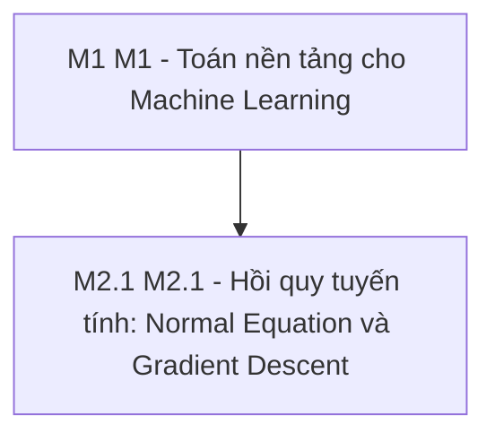

# Lộ trình Lộ trình Machine Learning - M1 & M2.1 Linear Regression (phiên bản 1.0, cập nhật 2026-10-11)

> Cài đặt và giải thích bản chất toán học của hồi quy tuyến tính với Normal Equation và Gradient Descent trên dữ liệu StudentScore, kiểm chứng đối chiếu với scikit-learn.. File: `polaris/ROADMAP.polaris.md`. Nguồn sự thật (source of truth): 01_Math_Foundations/math_primer.py, Notes/ML_Cheatsheet_Formulas.md, 00_Curriculum_and_Materials/GIAO_TRINH_CHI_TIET_TOAN_BO_KHOA_HOC.md, 02_Supervised_Learning/01_Regression/StudentScore.xls, 02_Supervised_Learning/01_Regression/regression.py.

## Mục lục

- [1. Cách dùng lộ trình này](#1-cách-dùng-lộ-trình-này)
- [2. Bức tranh toàn cảnh](#2-bức-tranh-toàn-cảnh)
- [3. Trạng thái hiện tại và lịch](#3-trạng-thái-hiện-tại-và-lịch)
- [4. Các module](#4-các-module)
- [5. Ôn tập giãn cách và ôn xen kẽ](#5-ôn-tập-giãn-cách-và-ôn-xen-kẽ)
- [6. Dự án tổng hợp](#6-dự-án-tổng-hợp)
- [7. Sổ lỗi và cách hỏi DeepTutor](#7-sổ-lỗi-và-cách-hỏi-deeptutor)
- [8. Tài liệu cũ trong thư mục này](#8-tài-liệu-cũ-trong-thư-mục-này)
- [9. Theo dõi tiến độ](#9-theo-dõi-tiến-độ)
- [10. Nguồn tham khảo](#10-nguồn-tham-khảo)

## 1. Cách dùng lộ trình này

**Nhãn:** **[Khóa học]** có trong video hoặc tài liệu chính thức; **[Mở rộng]** không có trong video, nguồn ngoài đã kiểm tra; **(chưa xác minh)** chưa kiểm chứng được, đừng coi là sự thật.

**Vòng lặp một module:** (1) tự chấm 0-2 từng dòng "Đầu ra"; (2) xem đoạn video/tài liệu, đối chiếu lời tiếng Anh trong transcript; (3) đọc "Kiến thức cốt lõi": mô hình tư duy trước, API sau; (4) predict-then-run (dự đoán rồi mới chạy): ghi dự đoán trước mọi lệnh, chỗ lệch là chỗ đáng học; (5) thực hành 3 tầng trong time box, lên tầng khi đạt DoD (Definition of Done: tiêu chí hoàn thành kiểm tra được); (6) viết câu trả lời rồi mới mở "Đáp án"; câu sai -> Sổ lỗi (mục 7) -> lịch ôn (mục 5).

**Buổi 60 phút:** 0-5 ôn câu đến hạn; 5-15 video/tài liệu; 15-50 thực hành một tầng (kẹt quá 15 phút thì hỏi DeepTutor, mục 7); 50-57 tự kiểm tra, Sổ lỗi; 57-60 ghi điểm dừng và việc kế tiếp. **Buổi 30 phút:** 5 phút ôn + một việc nhỏ (một tài liệu hoặc tầng Khởi động). Buổi lab có thể 90 phút.

## 2. Bức tranh toàn cảnh

### 2.1 Năng lực đầu ra

1. Viết phương trình hồi quy tuyến tính dạng ma trận với đúng shape từng thành phần và tính tay gradient của MSE, kiểm chứng bằng gradient số. (Kiểm tra: Gradient số và giải tích sai số tương đối < 1e-6 trên dữ liệu thực nghiệm chuẩn hóa.)
2. Dự đoán và phân tích được ảnh hưởng của learning rate (hội tụ, dao động, phân kỳ) và chuẩn hóa đặc trưng (feature scaling) đối với Gradient Descent. (Kiểm tra: Thực nghiệm GD với các giá trị eta khác nhau (0.001, 0.1, 1.1) đối chiếu giữa dự đoán và kết quả thực tế trên biểu đồ loss.)
3. Tự cài đặt Linear Regression bằng Normal Equation (phương trình pháp tuyến) và Gradient Descent từ đầu bằng NumPy trên dữ liệu StudentScore. (Kiểm tra: Hệ số hồi quy w, b từ Normal Equation và Gradient Descent sai khác scikit-learn LinearRegression dưới 1e-3 trên tập train/test StudentScore.)

### 2.2 Bản đồ module



### 2.3 Kiến thức nền cần có

Kiến thức đại số tuyến tính cơ bản (nhân ma trận, ma trận chuyển vị, nghiệm hệ phương trình), giải tích vi phân (đạo hàm riêng, quy tắc chuỗi), và lập trình NumPy/pandas cơ bản.

**Tự kiểm tra nhanh** (sai từ 2 câu thì ôn nền trước khi vào M1)
1. np.arange(6).reshape(2, 3).sum(axis=0) cho kết quả là gì?
2. Đạo hàm của f(x) = x^2 * e^x theo quy tắc tích?
3. Lấy trung bình math score theo từng giá trị gender của dataframe pandas thế nào?

<details><summary>Đáp án</summary>

1. array([3, 5, 7])
2. (x^2 + 2x) * e^x
3. df.groupby('gender')['math score'].mean()

</details>

### 2.4 Ngân sách thời gian

Khóa học ước lượng tổng cộng khoảng 3 giờ học. Với nhịp độ 3 giờ/tuần, lộ trình kéo dài khoảng 1 tuần. Tuần 1: 3 giờ (M1: 1.5 giờ, M2.1: 1.5 giờ) theo đúng kế hoạch lộ trình v2

## 3. Trạng thái hiện tại và lịch

### 3.1 Bạn đang ở đây

Khởi động Tuần 1: M1 Toán nền tảng và M2.1 Hồi quy tuyến tính từ đầu bằng NumPy.

### 3.2 Lịch theo tuần

| Tuần | Buổi | Module | Sản phẩm / DoD | Hạn |
|---|---|---|---|---|
| 1 | Buổi A (70m Toán nền) + Buổi B (95m Cài đặt StudentScore) + Ôn (15m) | M1 + M2.1 | m1_gradient_lab và m2_linreg_scratch đạt DoD, sai khác scikit-learn < 1e-3 | 2026-10-18 |

## 4. Các module

### Module M1 - M1 - Toán nền tảng cho Machine Learning (ước lượng: 1.5 giờ)

**Vì sao học:** Mọi thuật toán học có giám sát đều lặp lại mô thức: biểu diễn dữ liệu bằng ma trận, định nghĩa hàm mất mát toàn cục và tối ưu hóa tham số theo hướng ngược vector gradient.

**Đầu ra (làm được sau module):**
- [O1] Viết phương trình ma trận y_hat = X @ w + b chuẩn shape, tính giải tích gradient của MSE và kiểm chứng bằng gradient số với sai số tương đối < 1e-6.
- [O2] Dự đoán chính xác hành vi của Gradient Descent (hội tụ, dao động đổi dấu, phân kỳ) theo các giá trị learning rate eta và giải thích vai trò của chuẩn hóa đặc trưng.

**Kiến thức cốt lõi**
- **[Khóa học]** Dữ liệu được tổ chức thành ma trận X kích thước (n x d), dự đoán tuyến tính là tích vô hướng X @ w + b; lưu ý lỗi broadcasting khi trừ mảng (n,) với cột (n, 1) tạo ma trận vuông (n, n).
- **[Khóa học]** Hàm mất mát Mean Squared Error (MSE) có đạo hàm giải tích nabla J = (2/n) * X.T @ (X @ w - y), thể hiện hướng tăng dốc mạnh nhất của sai số.
- **[Khóa học]** Kiểm tra tính chính xác của gradient giải tích bằng sai phân đối xứng hai phía dJ/dw_j approx (J(w + eps*e_j) - J(w - eps*e_j)) / (2*eps) với epsilon xấp xỉ 1e-5.
- **[Khóa học]** Quy tắc cập nhật Gradient Descent w = w - eta * nabla J; trên hàm bậc hai f(w) = w^2, hệ số hồi quy cập nhật thành (1 - 2*eta)*w, hội tụ khi 0 < eta < 1 và phân kỳ khi eta > 1. Với quy ước loss 1/(2n), ngưỡng phân kỳ mở rộng thành eta > 2.
- **[Khóa học]** Chuẩn hóa đặc trưng (StandardScaler) đưa đường đồng mức elip dẹt về hình tròn đồng tâm, loại bỏ hiện tượng dao động zigzag và cho phép dùng learning rate lớn hơn để tăng tốc hội tụ.

**Hiểu lầm và lỗi hay gặp:**
- "Gradient là vector chỉ hướng xuống dốc dốc nhất của hàm mất mát." -> Gradient luôn chỉ hướng hàm số tăng nhanh nhất; thuật toán Gradient Descent phải đi ngược hướng gradient (trừ đi gradient) để hạ thấp hàm mất mát.
- "Trừ vector (n,) cho vector (n, 1) trong NumPy vẫn cho ra vector sai số kích thước (n,)." -> In .shape của phần dư y - X @ w trước khi tính norm hoặc dot product để đảm bảo mảng giữ đúng kích thước 1D (n,).

**Tài liệu**
- math_primer.py - Đạo hàm ma trận và Gradient Check (15 phút) - Đọc phần đạo hàm ma trận và kiểm tra gradient số
- ML_Cheatsheet_Formulas.md - Mục 1: Math Foundations (15 phút) - Các công thức tối ưu hóa bậc một và đạo hàm ma trận cơ bản
- [Stanford CS229 Lecture Notes - Supervised Learning & Gradient Descent](https://cs229.stanford.edu/main_notes.pdf) (20 phút) - Đọc Chương 1.1 LMS algorithm và Batch Gradient Descent
- [Wikipedia: Gradient descent](https://en.wikipedia.org/wiki/Gradient_descent) (20 phút) - Khái niệm gradient descent, step size và phân tích hội tụ trên hàm toàn phương

**Thực hành**
- Khởi động (15 phút): Ghi dự đoán kích thước (shape) của các biểu thức NumPy: X @ w, X - X.mean(axis=0), y - X @ w, và y - (X @ w).reshape(-1, 1) với X shape (100, 3), w shape (3,), y shape (100,) trước khi thực thi mã nguồn.. DoD: Bảng dự đoán shape ghi trước khi chạy; phát hiện và giải thích được lỗi broadcasting tạo ma trận (100, 100) trong Sổ lỗi nếu có..
- Cốt lõi (50 phút): Tạo notebook 01_Math_Foundations/m1_gradient_lab.ipynb: sinh 200 điểm thực nghiệm y = 3x + 2 + nhiễu; tự tính gradient giải tích của MSE và so khớp với gradient số đối xứng (epsilon = 1e-5); chạy vòng lặp Gradient Descent 100 bước với 3 learning rate eta in {0.001, 0.1, 1.1} sau khi ghi dự đoán trước.. DoD: Sai số tương đối giữa gradient giải tích và gradient số < 1e-6; hoàn thành bảng đối chiếu (eta, dự đoán, kết quả thực tế); nghiệm w, b của eta tối ưu khớp np.linalg.lstsq với sai số < 1e-3..
- Thử thách (20 phút): Tạo ma trận dữ liệu có 2 cột tương quan tuyến tính hoàn hảo, đo chỉ số điều kiện np.linalg.cond(X.T @ X) và quan sát hiện tượng số học khi giải Normal Equation.. DoD: Báo cáo 1 trang phân tích hình học chứng minh ma trận mất hạng cột dẫn đến không gian nghiệm vô hạn và chỉ số điều kiện cond tiến tới vô cùng..

**Tự kiểm tra**
1. (Áp dụng) Viết công thức gradient giải tích nabla J của hàm mất mát sai số toàn phương trung bình J(w) = (1/n) * ||X @ w - y||^2 theo vector w.
2. (Giải thích) Giải thích trực giác hình học vì sao việc chuẩn hóa đặc trưng (feature scaling) giúp thuật toán Gradient Descent hội tụ nhanh hơn và ổn định hơn?
3. (Dự đoán) Cho hàm mục tiêu bậc hai f(w) = w^2, điểm khởi tạo w_0 = 1, và tốc độ học eta = 0.75. Dự đoán giá trị của w_1, w_2 và nhận định thuật toán sẽ hội tụ, dao động hay phân kỳ?
4. (Dự đoán) Trong NumPy, cho mảng a có shape (3,) và mảng b có shape (3, 1). Dự đoán kết quả shape của phép trừ (a - b) và giải thích hiện tượng này.

<details><summary>Đáp án</summary>

1. nabla J = (2/n) * X.T @ (X @ w - y). Nếu dùng quy ước J = (1/(2n)) * ||X @ w - y||^2 thì nabla J = (1/n) * X.T @ (X @ w - y).
2. Khi các đặc trưng có thang đo chênh lệch lớn, các đường đồng mức của hàm mất mát bị kéo dài thành hình elip rất dẹt. Vector gradient luôn vuông góc với đường đồng mức nên không trỏ về tâm cực tiểu mà dao động ngoằn ngoèo. Chuẩn hóa đặc trưng giúp các đường đồng mức trở nên tròn đều, vector gradient trỏ thẳng về cực tiểu giúp bước nhảy đi thẳng và nhanh chóng hội tụ.
3. Đạo hàm f'(w) = 2w. Công thức cập nhật: w_(t+1) = w_t - 0.75*(2w_t) = (1 - 1.5)*w_t = -0.5 * w_t. Do đó w_1 = -0.5, w_2 = 0.25. Giá trị w đổi dấu qua mỗi bước (dao động) nhưng biên độ giảm dần về 0 (| -0.5 | < 1), do đó thuật toán dao động và hội tụ về 0.
4. Kết quả có shape (3, 3). Do quy tắc broadcasting, mảng a được mở rộng thành hàng (1, 3) rồi sao chép thành 3 hàng, mảng b được sao chép thành 3 cột, dẫn đến ma trận kích thước (3, 3) thay vì mảng 1D (3,). Đây là lỗi broadcasting phổ biến khi tính sai số hồi quy.

</details>

**Checkpoint:** [ ] Notebook m1_gradient_lab.ipynb đạt Definition of Done; [ ] Đạt tối thiểu 4/5 câu hỏi tự kiểm tra mà không mở tài liệu

### Module M2.1 - M2.1 - Hồi quy tuyến tính: Normal Equation và Gradient Descent (ước lượng: 1.5 giờ)

**Vì sao học:** Hồi quy tuyến tính là nền móng của học có giám sát; việc tự cài đặt từ đầu bằng cả nghiệm đóng và tối ưu hóa lặp giúp làm chủ cách siêu tham số điều khiển mô hình trước khi bước sang các thuật toán phức tạp hơn.

**Đầu ra (làm được sau module):**
- [O3] Tự cài đặt Linear Regression từ đầu bằng NumPy sử dụng Normal Equation và Gradient Descent trên tập dữ liệu StudentScore, đối chiếu hệ số khớp scikit-learn LinearRegression dưới 1e-3.
- Giải thích hình học của Ordinary Least Squares (hình chiếu trực giao lên không gian cột của X) và các điều kiện ma trận suy biến dẫn đến đa cộng tuyến.

**Kiến thức cốt lõi**
- **[Khóa học]** Trong hồi quy đơn biến, nghiệm giải tích đóng là w = sum((x_i - bar(x))*(y_i - bar(y))) / sum((x_i - bar(x))^2) và b = bar(y) - w*bar(x); tổng sai số phần dư sum(e_i) luôn bằng 0 khi mô hình có hệ số chặn b.
- **[Khóa học]** Trong hồi quy đa biến, điều kiện triệt tiêu gradient nabla J = 0 dẫn đến phương trình pháp tuyến (Normal Equation) X.T @ X @ w = X.T @ y, có nghiệm duy nhất khi ma trận thiết kế X có đầy đủ hạng cột.
- **[Mở rộng]** Bản chất hình học của OLS: vector dự đoán y_hat = X @ w_hat là hình chiếu trực giao của vector đích y lên không gian sinh bởi các cột của ma trận X, khiến vector phần dư e vuông góc với toàn bộ các đặc trưng.
- **[Khóa học]** Thư viện scikit-learn triển khai LinearRegression dựa trên phân tích SVD/QR của scipy.linalg.lstsq để tăng cường ổn định số học; đánh giá chất lượng mô hình bằng hệ số R^2 (có thể âm trên tập test).
- **[Khóa học]** Bộ dữ liệu StudentScore chứa thông tin điểm thi học sinh (thực chất định dạng CSV), yêu cầu chuẩn hóa thang đo bằng thống kê của tập huấn luyện trước khi áp dụng Gradient Descent để tránh rò rỉ dữ liệu và tối ưu tốc độ hội tụ.
- **[Mở rộng]** Đa cộng tuyến hoàn hảo khiến ma trận hiệp phương sai X.T @ X suy biến, chỉ số điều kiện bùng nổ và phương trình pháp tuyến không còn nghiệm duy nhất.

**Hiểu lầm và lỗi hay gặp:**
- "Hệ số xác định R^2 luôn nằm trong đoạn [0, 1] trên mọi tập dữ liệu kiểm tra." -> R^2 chỉ bị chặn dưới bởi 0 trên tập huấn luyện của OLS có hệ số chặn; trên tập kiểm tra (test set), nếu mô hình dự đoán tệ hơn cả giá trị trung bình thì R^2 hoàn toàn có thể nhận giá trị âm.
- "Cách tốt nhất để giải Normal Equation trong thực tế là dùng np.linalg.inv(X.T @ X)." -> Nghịch đảo trực tiếp X.T @ X rất dễ gặp lỗi số học khi ma trận gần suy biến (ill-conditioned); các thư viện chuẩn như scikit-learn dùng phân tích SVD hoặc QR để giải bình phương tối thiểu ổn định hơn.

**Tài liệu**
- Giáo trình Khóa học - Lesson 05: Linear Regression (15 phút) - Bài giảng lý thuyết về Hồi quy tuyến tính, hàm mất mát và phương trình pháp tuyến
- regression.py - Student Score Prediction Pipeline (15 phút) - Xem cách triển khai pipeline tiền xử lý StandardScaler và RandomForest baseline
- [scikit-learn User Guide - 1.1.1 Ordinary Least Squares](https://scikit-learn.org/stable/modules/linear_model.html) (25 phút) - Mục 1.1.1 Ordinary Least Squares và lưu ý triển khai qua scipy.linalg.lstsq
- [An Introduction to Statistical Learning (ISLP) - Chương 3: Linear Regression](https://www.statlearning.com/) (25 phút) - Chương 3: Phân tích hình học OLS, ước lượng hệ số và hiện tượng đa cộng tuyến

**Thực hành**
- Khởi động (15 phút): Tính nghiệm giải tích w, b bằng công thức giải tích đóng cho 3 điểm dữ liệu đơn giản (1, 1), (2, 2), (3, 2), sau đó kiểm tra lại bằng np.polyfit(x, y, 1).. DoD: Kết quả tính tay khớp np.polyfit đến 3 chữ số thập phân; giải thích lý do toán học vì sao tổng phần dư triệt tiêu về 0 khi mô hình có hệ số chệch b..
- Cốt lõi (55 phút): Tạo notebook 02_Supervised_Learning/01_Regression/m2_linreg_scratch.ipynb: đọc dữ liệu StudentScore.xls bằng pd.read_csv, thiết lập bài toán dự đoán math score từ reading score và writing score; chia tập 80/20, chuẩn hóa đặc trưng bằng thống kê của train; tự lập trình hai phương pháp tìm nghiệm: Normal Equation và Gradient Descent từ đầu bằng NumPy.. DoD: Không xảy ra rò rỉ dữ liệu (chỉ dùng mean và std của train để transform test); hệ số w và bias b giữa Normal Equation, Gradient Descent và scikit-learn LinearRegression sai khác dưới 1e-3..
- Thử thách (20 phút): Thực hiện thí nghiệm loại bỏ bước chuẩn hóa đặc trưng trước khi chạy Gradient Descent trên StudentScore, đo số vòng lặp và mức độ dao động của hàm mất mát.. DoD: Biểu đồ đường cong hàm mất mát MSE qua 200 vòng lặp so sánh giữa có và không chuẩn hóa; giải thích tại sao không chuẩn hóa buộc learning rate phải giảm ít nhất 10 lần..

**Tự kiểm tra**
1. (Giải thích) Vì sao trong bài toán hồi quy tuyến tính đơn biến có hệ số chặn (bias b), tổng của tất cả các phần dư sum(y_i - y_hat_i) luôn bằng 0?
2. (Giải thích) Giải thích ý nghĩa hình học của vector dự đoán y_hat trong không gian Euclid n chiều đối với phương pháp bình phương tối thiểu OLS.
3. (Dự đoán) Dự đoán giá trị của hệ số xác định R^2 trên tập kiểm tra (test set) khi mô hình đưa ra dự đoán kém hơn mức trung bình của tập huấn luyện.
4. (Nhớ) Tại sao scikit-learn sử dụng scipy.linalg.lstsq thay vì nghịch đảo trực tiếp np.linalg.inv(X.T @ X) để giải bài toán Ordinary Least Squares?

<details><summary>Đáp án</summary>

1. Hệ số chặn b được xác định bằng cách đặt đạo hàm riêng của tổng bình phương phần dư theo b bằng 0: d(sum (y_i - w*x_i - b)^2) / db = -2 * sum(y_i - y_hat_i) = 0. Do đó tổng các phần dư triệt tiêu hoàn toàn về 0.
2. Trong không gian n chiều của các quan sát mẫu, vector dự đoán y_hat = X @ w là hình chiếu trực giao của vector nhãn thực tế y lên không gian con tạo bởi các cột của ma trận thiết kế X. Khoảng cách Euclid ||y - y_hat|| ngắn nhất khi vector sai số e = y - y_hat vuông góc trực giao với mọi vector cột của X.
3. Hệ số R^2 = 1 - (SS_res / SS_tot). Khi tổng bình phương sai số dự đoán SS_res lớn hơn tổng bình phương độ lệch so với trung bình SS_tot, phân số lớn hơn 1 dẫn đến R^2 nhận giá trị âm.
4. Nghịch đảo trực tiếp X.T @ X tốn chi phí tính toán O(d^3), làm bình phương chỉ số điều kiện cond(X)^2 khiến sai số số học tăng vọt và báo lỗi nếu ma trận suy biến. scipy.linalg.lstsq sử dụng phân tích SVD hoặc QR để tìm nghiệm bình phương tối thiểu ổn định số học và xử lý được trường hợp ma trận không khả nghịch.

</details>

**Checkpoint:** [ ] Notebook m2_linreg_scratch.ipynb đạt Definition of Done; [ ] Hệ số hồi quy khớp scikit-learn LinearRegression dưới sai số 1e-3; [ ] Đạt tối thiểu 4/5 câu hỏi tự kiểm tra mà không mở tài liệu

## 5. Ôn tập giãn cách và ôn xen kẽ

Mỗi lượt 5-10 phút: trả lời lại 2-3 câu tự kiểm tra (ưu tiên câu từng sai), đọc lại Sổ lỗi của module; đúng cả lượt D+7 và D+21 thì coi là vững. Ngày ôn không phải ngày học thì làm đầu buổi gần nhất; học trễ thì tính lại từ ngày xong thật.

| Module | Học xong | D+1 | D+3 | D+7 | D+21 |
|---|---|---|---|---|---|
| M1 | 2026-10-12 | 2026-10-13 | 2026-10-15 | 2026-10-19 | 2026-11-02 |
| M2.1 | 2026-10-14 | 2026-10-15 | 2026-10-17 | 2026-10-21 | 2026-11-04 |

**Ôn xen kẽ** (30 phút, trộn module):
- **Ôn tập xen kẽ #1: Tối ưu hóa giải tích vs Tối ưu hóa lặp (2026-10-18):** So sánh Gradient Descent vs Normal Equation: độ phức tạp tính toán O(n*d^2 + d^3) vs O(k*n*d), yêu cầu bộ nhớ và độ nhạy thang đo đặc trưng

## 6. Dự án tổng hợp

**Linear Regression Pipeline & Scratch Benchmark:** Xây dựng pipeline hồi quy hoàn chỉnh trên StudentScore: tiền xử lý, kiểm tra gradient số, tự cài đặt Normal Equation và GD, đánh giá R^2, MSE, đối chiếu scikit-learn.
- **DoD:** Báo cáo thực nghiệm so sánh nghiệm đóng, GD và scikit-learn sai khác < 1e-3, giải thích hình học và các cạm bẫy broadcasting/scaling.
- **Phạm vi:** StudentScore.xls; 01_Math_Foundations; 02_Supervised_Learning/01_Regression

## 7. Sổ lỗi và cách hỏi DeepTutor

**Mẫu Sổ lỗi** (`so_loi.md`, mỗi lỗi một mục):

```text
Ngày | Module | Loại gap: cấu trúc / ca biên / cú pháp / quy trình
Triệu chứng (lỗi chính xác, lệnh đã chạy):
Giả thuyết ban đầu:      Nguyên nhân gốc:      Cách sửa:
Quy tắc rút ra ("Khi ... thì ..."):      Ôn lại: D+1, D+7
```

**Hỏi DeepTutor.** Thang gợi ý 5 mức: (1) chỉ ra triệu chứng; (2) câu hỏi dẫn dắt (ranh giới, bất biến, luồng dữ liệu); (3) phản ví dụ tối thiểu; (4) mã giả hoặc chữ ký API; (5) code đầy đủ chỉ khi bạn nói rõ "Show me the full code". Hỏi "giải giúp bài này" mà không kèm suy luận thì chỉ nhận mức 1-2. Mẫu: **Mục tiêu** (bài, DoD) / **Đã thử** (2-3 việc, kết quả) / **Lỗi chính xác** (nguyên văn, kèm lệnh) / **Giả thuyết** / **Mức gợi ý muốn nhận**. Không dán API key hay nội dung `.env`.

## 8. Tài liệu cũ trong thư mục này

| File cũ | Dùng được? | Dùng cho việc gì |
|---|---|---|
| [01_Regression/regression.py](01_Regression/regression.py) | Khung tiền xử lý đặc trưng số và phân loại | Tham khảo cấu trúc ColumnTransformer và Pipeline scikit-learn baseline |
| [01_Math_Foundations/math_primer.py](01_Math_Foundations/math_primer.py) | Hàm kiểm tra gradient số đối xứng | Mã nguồn đối chiếu kiểm tra gradient và vector hóa ma trận NumPy |

## 9. Theo dõi tiến độ

- [ ] M1 Toán nền tảng cho ML: m1_gradient_lab.ipynb đạt Definition of Done
- [ ] M2.1 Hồi quy tuyến tính: m2_linreg_scratch.ipynb đạt Definition of Done
- [ ] Capstone: Báo cáo thực nghiệm so sánh nghiệm đóng, GD và scikit-learn hoàn thành

## 10. Nguồn tham khảo

| Tên | URL / Đường dẫn | Nhãn | Chất lượng |
|---|---|---|---|
| [math_primer.py - Vector and Matrix Calculus Foundations](D:/02_Learning_Knowledge/Machine_Learning/01_Math_Foundations/math_primer.py) | D:/02_Learning_Knowledge/Machine_Learning/01_Math_Foundations/math_primer.py | **[Khóa học]** | 5/5 (Local course material providing matrix derivative implementations and numerical gradient checks.) |
| [GIAO_TRINH_CHI_TIET_TOAN_BO_KHOA_HOC.md - Lesson 05: Linear Regression](D:/02_Learning_Knowledge/Machine_Learning/00_Curriculum_and_Materials/GIAO_TRINH_CHI_TIET_TOAN_BO_KHOA_HOC.md) | D:/02_Learning_Knowledge/Machine_Learning/00_Curriculum_and_Materials/GIAO_TRINH_CHI_TIET_TOAN_BO_KHOA_HOC.md | **[Khóa học]** | 5/5 (Primary curriculum document covering linear regression theory, loss functions, and normal equation.) |
| [regression.py & StudentScore.xls - Baseline Implementation & Dataset](D:/02_Learning_Knowledge/Machine_Learning/02_Supervised_Learning/01_Regression/regression.py) | D:/02_Learning_Knowledge/Machine_Learning/02_Supervised_Learning/01_Regression/regression.py | **[Khóa học]** | 5/5 (Local course reference script and dataset for regression experiments.) |
| [scikit-learn User Guide: 1.1.1 Ordinary Least Squares](https://scikit-learn.org/stable/modules/linear_model.html) | https://scikit-learn.org/stable/modules/linear_model.html | **[Khóa học]** | 5/5 (Official documentation for scikit-learn LinearRegression, normal equation solving via scipy.linalg.lstsq.) |
| [scikit-learn User Guide: 1.5 Stochastic Gradient Descent](https://scikit-learn.org/stable/modules/sgd.html) | https://scikit-learn.org/stable/modules/sgd.html | **[Khóa học]** | 5/5 (Official documentation for SGDRegressor, detailing loss functions, learning rate schedules, and scaling sensitivity.) |
| [An Introduction to Statistical Learning (ISLP) - Chapter 3: Linear Regression](https://www.statlearning.com/) | https://www.statlearning.com/ | **[Mở rộng]** | 5/5 (Gold-standard statistical learning textbook providing geometric interpretation of OLS and residuals.) |
| [Stanford CS229 Lecture Notes: Supervised Learning, Linear Regression & Gradient Descent](https://cs229.stanford.edu/main_notes.pdf) | https://cs229.stanford.edu/main_notes.pdf | **[Mở rộng]** | 5/5 (Foundational Stanford CS229 course notes covering LMS algorithm, batch gradient descent, and normal equations derivation via trace/matrix calculus.) |
| [Influence of Feature Scaling on Convergence of Gradient Iterative Algorithm](https://doi.org/10.1088/1742-6596/1213/3/032021) | https://doi.org/10.1088/1742-6596/1213/3/032021 | **[Mở rộng]** | 4/5 (Peer-reviewed analysis demonstrating how feature scaling balances Hessian eigenvalues and eliminates zigzag oscillations in gradient descent.) |
| [Wikipedia: Gradient descent](https://en.wikipedia.org/wiki/Gradient_descent) | https://en.wikipedia.org/wiki/Gradient_descent | **[Mở rộng]** | 4/5 (Comprehensive overview of first-order optimization, step size selection, convergence on quadratic functions, and history.) |
| [Special Properties of Gradient Descent with Large Learning Rates](https://arxiv.org/abs/2205.15142) | https://arxiv.org/abs/2205.15142 | **[Mở rộng]** | 4/5 (Open-access arXiv paper on gradient descent dynamics with large learning rates on quadratic/linear problems.) |
