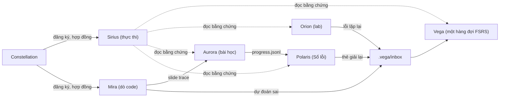

# Rà soát hệ thống học và các dự án mới (12/10/2026)

> Kết quả của một phiên nghiên cứu và xây dựng: chẩn đoán từ dữ liệu thật của hub, tổng hợp bằng chứng khoa học về cách học, hai MCP mới (Sirius, Mira) và nâng cấp năm dự án cũ để chúng chạy thành một hệ thống. Cuối file có việc bạn cần làm và các câu hỏi tự kiểm tra.

## 1. Tóm tắt

- **Điểm nghẽn là thực thi, không phải thiếu công cụ.** Trong 21 ngày có 2 commit là bài bạn tự làm (cả hai thuộc Python Master), trong khi hệ thống công cụ đã có 6 MCP và lộ trình được viết lại sau 3 tuần.
- **Đã làm:** 2 MCP mới (Sirius: vòng thực thi; Mira: dò code từng dòng) và nâng cấp Vega 0.3.0, Polaris 0.4.0, Orion 0.2.0, Aurora 0.8.0, Constellation 0.1.7, SmartDrive, `pick_today.py`. Mọi dự án đều qua toàn bộ test.
- **Cố ý không làm:** Altair (luyện gọi lại có lịch riêng). Bằng chứng cho thấy thêm một bộ lập lịch ôn thứ ba sẽ tạo nợ ôn; thay vào đó mọi thứ cần ôn giờ đổ về một hàng đợi duy nhất trong Vega.
- **Đã phân loại 60 task quá hạn** theo xác nhận của bạn (55 đã thay thế, 5 tạm gác). Cảnh báo quá hạn giảm từ 62 xuống 2 việc thật.

## 2. Chẩn đoán từ dữ liệu (00:47, 12/10/2026)

| Chỉ số | Giá trị | Ý nghĩa |
| :--- | :--- | :--- |
| Task quá hạn chưa đóng | 62 (57 thuộc kế hoạch v1 đã bị lộ trình v2 thay thế) | Cảnh báo nhiễu đến mức `pick_today.py` khóa bạn vào việc "dọn slide" đã bị bỏ |
| Commit bài tự làm trong 21 ngày | 2 (Python Master, 21/9 và 1/10) | GCI vẫn nộp đủ (HW3 3/3) vì có hạn thật; 4 khóa tự học đứng yên |
| Thẻ Vega | 4 thẻ, 0 lần ôn | Công cụ ôn có sẵn nhưng chưa thành thói quen |
| Lab Orion | 1 lab, 0 lần chạy | Bài "viết từ file trống" có ngưỡng vào quá cao |
| Thời gian học theo kế hoạch | Polaris: 1,5 giờ/tuần; lộ trình tổng: 14-16 giờ/tuần | Không công cụ nào đo giờ học thật |
| Ô tiến độ trong 5 lộ trình | 0 ô được tick | Quá nhiều nơi theo dõi tiến độ |
| Test gốc của hub | 9/22 đang lỗi (do dữ liệu đổi, có từ trước) | Không liên quan thay đổi lần này |

## 3. Bằng chứng khoa học và quyết định thiết kế

| Kỹ thuật | Bằng chứng | Áp dụng trong hệ thống |
| :--- | :--- | :--- |
| Luyện truy xuất (tự kiểm tra) | g khoảng 0,50 so với đọc lại; có phản hồi thì mạnh hơn hẳn [1][3] | Mira bắt dự đoán ở điểm dừng; dự đoán sai thành thẻ Vega |
| Ôn giãn cách, lịch thích ứng | Giãn nở dần và giãn đều như nhau; lịch cá nhân hóa tốt hơn lịch cố định [7][8] | Một hàng đợi FSRS duy nhất (Vega); Polaris thôi lập lịch D+1..D+35 |
| Học lại liên tiếp | Đạt 3 lần nhớ đúng rồi ôn lại cách quãng: lợi lớn sau 1-4 tháng [4] | Sổ lỗi thành thẻ "giải lại", không phải "đọc lại" |
| Dò code trước khi viết | Dạy dò code trước giúp viết đúng hơn [33]; PRIMM [27] | Mira; Orion gợi ý dò code ở gợi ý mức 3 |
| Ví dụ mẫu rồi giảm dần hỗ trợ | Người mới cần hỗ trợ cao (d = 0,5), người giỏi thì ngược lại [30][32] | Orion: bậc khởi động (ví dụ mẫu, hoàn thiện, Parsons, sửa) trước "tự viết" |
| Luyện debug | g = 0,64 [34] | Mira và Orion; đề xuất bài tập "sửa 1 dòng" sinh từ code của chính bạn |
| Kế hoạch "khi... thì..." | d = 0,65 [18] | `sirius_commit` |
| Ước lượng thời gian | Người ta đánh giá thấp thời gian cần; dùng thời gian thật đã đo thì hết lệch [21][22] | Sirius đo tỉ lệ thực tế / ước lượng và năng lực tuần thật |
| Tự theo dõi tiến độ | d = 0,40; mạnh hơn khi ghi lại và chia sẻ [25] | Tổng kết tuần của Sirius có đoạn 5 dòng để chia sẻ |
| Hình thành thói quen | Trung vị khoảng 66 ngày; lỡ một ngày không sao [24] | Chuỗi ngày học của Sirius không gãy khi lỡ 1 ngày; mức tối thiểu 25 phút/ngày |

**Hiệu quả thấp với các môn của bạn:**
- Memory palace, hình neo, mnemonic cho ML, Quantum, Python, Agents: bị xếp "hiệu quả thấp" [11], bằng chứng về loci mỏng và không có nghiên cứu trên nội dung khái niệm [13], lại tốn công soạn. Chỉ nên giữ cho danh sách tùy ý.
- Thêm công cụ lập kế hoạch: kế hoạch "trường hợp xấu nhất" vẫn trễ [21]; can thiệp tự điều chỉnh trên khoảng 250.000 người học MOOC tăng tương tác ban đầu nhưng không tăng tỉ lệ hoàn thành [20].
- Hỏi độ tự tin sau một thời gian cho bài lập trình làm độ chính xác tự đánh giá kém đi [16].

## 4. Những gì đã xây

### 4.1 Sirius MCP 0.1 (mới): vòng thực thi
`D:/03_Development_Projects/ai_agents/sirius_mcp` · 10 tool · e2e 261/261.
- `sirius_deadlines`: luật hạn chót của AGENTS.md thành công cụ (quá hạn, dưới 24/48/72 giờ, đếm ngược chính xác), gộp task trùng giữa các bảng, phát hiện hạn không thống nhất.
- `sirius_triage`: gợi ý phân loại task cũ; chỉ ghi quyết định bạn đã xác nhận, không bao giờ sửa TASKS.md.
- `sirius_today`: hôm nay học gì theo tuần mẫu của lộ trình tổng, hạn chót được ưu tiên, kèm bước tiếp theo (Polaris, Vega, Orion).
- `sirius_commit`, `sirius_start`/`sirius_stop`, `sirius_log`: cam kết "khi... thì...", bấm giờ, ghi phiên học.
- `sirius_week`, `sirius_stats`: kế hoạch so với thực tế theo khóa, bằng chứng học thật (Orion, Vega, Aurora, Mira, Sổ lỗi, git), thời gian học so với thời gian làm công cụ, năng lực tuần thật, chuỗi ngày học.
- Dữ liệu ở `.sirius/` (có `.gitignore` riêng nên không thể lọt lên repo public).

### 4.2 Mira MCP 0.1 (mới): dò code từng dòng
`D:/03_Development_Projects/ai_agents/mira_mcp` · 8 tool · e2e 289/289 (gồm 31 kiểm tra bố cục trên Chrome thật: không tràn ngang ở 79 tình huống và 1.573 kích thước màn hình từ 320 đến 1920 px).
- `mira_record`: chạy code Python thật dưới `sys.settrace`, ghi từng dòng đã chạy và biến nào đổi; không dựng bước giả.
- `mira_build`, `mira_check`: dựng một trang HTML chạy offline (code, bảng biến, khung hình ảnh hóa: mảng, lưới, đồ thị, statevector, đồ thị loss; bộ đếm; thanh tua) với **điểm dừng bắt buộc dự đoán** trước khi xem kết quả.
- `mira_drill`: tự tạo bài dò từ một hàm bạn đã làm xong trong Python Master (lấy lời gọi từ docstring, chọn điểm dừng ở vòng lặp và trước `return`); từ chối hàm còn chỗ trống `___1___`.
- `mira_demo`: A* và Dijkstra trên cùng lưới 18x28 (A* xét 54 ô, Dijkstra 310 ô, cùng đường đi 24 ô). Đây là bài trình diễn duy nhất; Mira không viết lời giải cho bài tập của bạn.
- `mira_progress { to_vega: true }`: điểm dừng đoán sai thành thẻ Vega, bấm vào thẻ mở lại đúng điểm dừng (`#stop-k`).
- Nhúng được vào bài học Aurora bằng slide `trace`; kết quả dự đoán đi vào `progress.jsonl` như mọi slide khác.

### 4.3 Nâng cấp các dự án cũ

| Dự án | Phiên bản | e2e | Thay đổi |
| :--- | :--- | :--- | :--- |
| Vega | 0.2.2 -> 0.3.0 | 207/207 | Hộp thư thẻ `.vega/inbox/` (hợp đồng `vega-card-inbox.v1`), tool `vega_inbox`, `vega_sync` tự nhận thẻ, liên kết ngược về nguồn |
| Polaris | 0.3.6 -> 0.4.0 | 291/291 | Lịch ôn chuyển sang Vega khi có `.vega/`; Sổ lỗi giữ nguyên; bài học xong thì câu tự kiểm tra thành thẻ |
| Orion | 0.1.0 -> 0.2.0 | 214/214 | Bậc khởi động PRIMM (`orion_stage`), gợi ý dò code bằng Mira ở mức 3, xuất thẻ vào hộp thư Vega |
| Aurora | 0.7.1 -> 0.8.0 | 126/126 | Slide `trace` nhúng trình Mira; kết quả dự đoán vào `progress.jsonl` |
| Constellation | 0.1.6 -> 0.1.7 | 146/146 | Hợp đồng `vega-card-inbox.v1`, `mira-embed.v1`; `.sirius/` trong hợp đồng dữ liệu cá nhân |
| SmartDrive | (không đổi số) | 52/52 phần gitignore; 943 toàn bộ | `.sirius/` trong mẫu bỏ qua |
| `pick_today.py` | | 63 đạt, 9 lỗi cũ | Bỏ qua task đã phân loại; cờ `--no-triage` |

### 4.4 Các mảnh nối với nhau thế nào

## 5. Dùng mỗi ngày (khoảng 2 phút nghi thức)

1. Mở phiên với agent: "Hôm nay học gì?". Agent gọi `sirius_deadlines` rồi `sirius_today`.
2. Đặt một cam kết: "Khi 20:00 ở bàn học, mình mở luyen_tap bài kế tiếp trong 25 phút" (`sirius_commit`).
3. Bắt đầu bấm giờ (`sirius_start`), học, rồi dừng (`sirius_stop`) và ghi kết quả.
4. Với code: dò trước bằng Mira (`mira_drill` cho bài Python Master); với lab Orion, đi từ bậc khởi động.
5. Ôn: `vega_sync` rồi `vega_session` (một hàng đợi duy nhất).
6. Chủ Nhật: `sirius_week { write: true }` rồi gửi đoạn "Bản tóm tắt để chia sẻ" cho một người bạn học.

## 6. Việc của bạn

**Ngay hôm nay**
- Khởi động lại Claude Code và Antigravity để nạp Sirius, Mira và các bản nâng cấp.
- Làm 2 việc GCI quá hạn thật (đổi tên Slack thành Duongne2000, đọc Notion Student Guide) rồi tick trong `GCI_World_2026_September/TASKS.md`.
- Python Master: 1 bài trong `luyen_tap` trước 23:59.

**Cần bạn quyết định**
- Commit: chưa commit gì. Các repo có thay đổi: sirius_mcp và mira_mcp (chưa có git; theo quy ước của bạn có thể tạo bằng `git init --separate-git-dir C:/Users/Admin/.git-dirs/<tên>.git`), vega_mcp, polaris_mcp, orion_mcp, constellation_mcp, smart_drive_os, aurora_slides_mcp (phiên "Nâng cấp slide tương tác" gom thành một commit 0.8.0 sau khi bạn xem), và hub (`pick_today.py`, `test_sirius_triage_interop.py`; repo hub là public nên chỉ stage đúng đường dẫn).
- Constellation báo một lỗi có từ trước, không liên quan lần này: `node_repl` của Codex trỏ tới file không còn tồn tại.
- Đóng băng việc sửa lộ trình đến khi có 3 tuần dữ liệu Sirius; sau đó đặt ngân sách giờ theo năng lực đo được.
- Cài thêm (tự bạn cài vì tải phần mềm ngoài): Context7 (tài liệu pandas/scikit-learn/qiskit-aer cập nhật), `qiskit-docs-mcp-server` (tài liệu Qiskit 2.x chính thức). Cân nhắc: ActivityWatch (đo thời gian thật, chạy cục bộ), add-on AnkiMCP nếu muốn ôn trên điện thoại (khi đó chỉ để một bộ lập lịch).
- Hồ sơ Polaris: bỏ "memory anchors" khỏi phương pháp mặc định cho môn khái niệm; thêm `.sirius/` vào `.gitignore` gốc nếu muốn (đã có lớp bảo vệ bên trong).

**Đề xuất làm sau (chưa làm)**
- Aurora: mở bài bằng 2-3 câu hỏi trước (prequestion), dùng palace/mnemonic chỉ cho danh sách tùy ý. Hoãn vì phiên "Nâng cấp slide tương tác" đang sửa Aurora.
- Orion: bài tập "sửa 1 dòng" sinh từ code đã đúng của chính bạn (định dạng COS Pro).
- Dọn 3 cặp hạn không thống nhất trong GCI (`sirius_deadlines` liệt kê) và 9 test gốc đang lỗi.

## 7. Kế hoạch 7 ngày đo bằng Sirius

| Ngày | Tối thiểu | Đo bằng |
| :--- | :--- | :--- |
| Mỗi ngày | 25 phút học thật (không tính làm công cụ) | `sirius_today`: dòng "Mức tối thiểu" đạt |
| Thứ Hai 12/10 | Python Master 1 bài + 4 thẻ Vega | phiên Sirius + `vega_stats` có 4 lượt ôn |
| Thứ Ba đến Thứ Bảy | Theo tuần mẫu; trước buổi GCI thứ Năm: 1 trình Mira hoặc 3 câu hỏi trước | phiên Sirius theo khóa |
| Chủ Nhật 18/10 | `sirius_week { write: true }` | file `Roadmaps/weekly_reviews/2026-W42.md` |

Definition of Done của tuần: ít nhất 5 ngày có phiên học, ít nhất 1 lab Orion có lần chạy đầu tiên, có bản tổng kết tuần.

## 8. Tự kiểm tra

1. Vì sao hệ thống không thêm bộ lập lịch ôn thứ ba, và cái gì thay vào?
2. Trình dò Mira chỉ "cho xem từng dòng" thì vì sao gần như không giúp nhớ; nó phải bắt bạn làm gì ở điểm dừng?

## 9. Tài liệu tham khảo

Số trong ngoặc vuông ở mục 3 trỏ tới danh sách này. Mọi DOI đã được mở kiểm tra trong phiên nghiên cứu.

1. Rowland (2014). The effect of testing versus restudy on retention. Psychological Bulletin. doi:10.1037/a0037559
2. Adesope, Trevisan, Sundararajan (2017). Rethinking the use of tests. Review of Educational Research. doi:10.3102/0034654316689306
3. Yang et al. (2021). Testing (quizzing) boosts classroom learning. Psychological Bulletin. doi:10.1037/bul0000309
4. Rawson, Dunlosky (2011). Optimizing schedules of retrieval practice. Journal of Experimental Psychology: General. doi:10.1037/a0023956
7. Latimier, Peyre, Ramus (2021). Spacing out retrieval practice episodes. Educational Psychology Review. doi:10.1007/s10648-020-09572-8
8. Lindsey et al. (2014). Personalized review improves long-term retention. Psychological Science. doi:10.1177/0956797613504302
11. Dunlosky et al. (2013). Improving students' learning with effective learning techniques. Psychological Science in the Public Interest. doi:10.1177/1529100612453266
13. Twomey, Kroneisen (2021). The effectiveness of the loci method. Quarterly Journal of Experimental Psychology. doi:10.1177/1747021821993457
16. Janssen, Lazonder (2024). Interventions for monitoring accuracy in problem solving. Educational Psychology Review. doi:10.1007/s10648-024-09936-4
18. Gollwitzer, Sheeran (2006). Implementation intentions and goal achievement. Advances in Experimental Social Psychology. doi:10.1016/S0065-2601(06)38002-1
20. Kizilcec et al. (2020). Scaling up behavioral science interventions in online education. PNAS. doi:10.1073/pnas.1921417117
21. Buehler, Griffin, Ross (1994). Exploring the "planning fallacy". Journal of Personality and Social Psychology. doi:10.1037/0022-3514.67.3.366
22. Roy, Mitten, Christenfeld (2008). Correcting memory improves accuracy of predicted task duration. Journal of Experimental Psychology: Applied. doi:10.1037/1076-898X.14.3.266
24. Lally et al. (2010). How are habits formed. European Journal of Social Psychology. doi:10.1002/ejsp.674
25. Harkin et al. (2016). Does monitoring goal progress promote goal attainment? Psychological Bulletin. doi:10.1037/bul0000025
27. Sentance, Waite, Kallia (2019). Teaching computer programming with PRIMM. Computer Science Education. doi:10.1080/08993408.2019.1608781
30. Atkinson, Renkl, Merrill (2003). Transitioning from studying examples to solving problems. Journal of Educational Psychology. doi:10.1037/0022-0663.95.4.774
32. Tetzlaff et al. (2025). A meta-analysis of the expertise reversal effect. Learning and Instruction. doi:10.1016/j.learninstruc.2025.102142
33. Xie et al. (2019). A theory of instruction for introductory programming skills. Computer Science Education. doi:10.1080/08993408.2019.1565235
34. Sun, Yang, Becker (2024). Debugging in computational thinking: a meta-analysis. Journal of Educational Computing Research. doi:10.1177/07356331241227793

Về trực quan hóa thuật toán (cơ sở cho thiết kế "chủ động" của Mira): Hundhausen, Douglas, Stasko (2002), A meta-study of algorithm visualization effectiveness, Journal of Visual Languages and Computing; Naps et al. (2002), Exploring the role of visualization and engagement in computer science education, ITiCSE Working Group Reports. Hai nguồn này được trích từ hiểu biết sẵn có, chưa mở lại trong phiên này.
